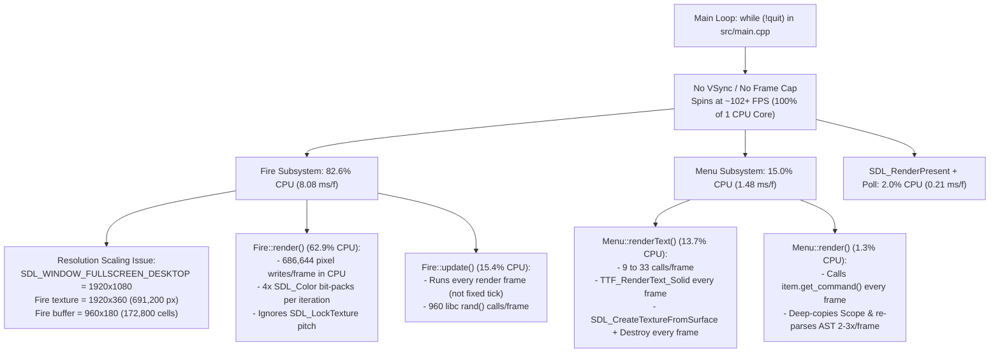

# Performance Profiling Report & Optimization Plan

This document details the profiling investigation of [`build/doomlauncher`](file:///home/kgorelov/git/doomlauncher/build/doomlauncher) to diagnose why the application consumes **100% CPU**, identifies every runtime and startup bottleneck with empirical measurements, and lays out a phased optimization plan.

---

## 1. Executive Summary

Profiling [`build/doomlauncher`](file:///home/kgorelov/git/doomlauncher/build/doomlauncher) at the desktop output resolution of **1920x1080** (`SDL_WINDOW_FULLSCREEN_DESKTOP`) reveals **five compounding root causes** behind the 100% CPU utilization:

1. **Unthrottled Busy-Wait Main Loop & Missing VSync ([`src/main.cpp`](file:///home/kgorelov/git/doomlauncher/src/main.cpp#L79), [`src/main.cpp`](file:///home/kgorelov/git/doomlauncher/src/main.cpp#L161-L187))**:
   - `SDL_CreateRenderer` is called with `SDL_RENDERER_ACCELERATED` (`0x2`) without `SDL_RENDERER_PRESENTVSYNC`, and the `while (!quit)` loop contains no frame limiter (`SDL_Delay`) or event timeout.
   - Consequently, the main loop runs as fast as a single CPU core can execute (~102–113 FPS at `-O0`, `9.78 ms/frame`), pegging **96.2%–97.8% of a CPU core** continuously even when the menu is completely idle.
   - Even if per-frame CPU work is reduced by 10x, without VSync or frame pacing the loop will simply spin at 1,000+ FPS and still consume 100% CPU.

2. **Full-Desktop-Resolution CPU Pixel Manipulation in `Fire::render()` & `Fire::update()` ([`src/fire.cpp`](file:///home/kgorelov/git/doomlauncher/src/fire.cpp#L6-L158)) — 82.6% of Frame CPU Time (`8.08 ms/frame`)**:
   - Because `SDL_WINDOW_FULLSCREEN_DESKTOP` overrides the nominal `800x600` constants with the native display size (`1920x1080`), `Fire` allocates a `1920x360` streaming texture (**691,200 pixels**, 2.76 MB/frame) and a `960x180` simulation buffer (**172,800 cells**, 4.32x larger than at `800x600`).
   - `Fire::render()` spends **6.13 ms/frame (62.9% of total CPU)** executing 686,644 software bilinear-like upscaling operations, `std::vector::operator[]` lookups, and `SDL_Color` bit-packing operations (`(a << 24) | (r << 16) | (g << 8) | b`) on the CPU every frame, followed by **0.45 ms/frame (4.5% CPU)** in `SDL_UnlockTexture` uploading 2.76 MB to the GPU (~282 MB/s at 102 FPS).
   - `Fire::update()` spends **1.50 ms/frame (15.4% of total CPU)** simulating 172,800 cells and calling `libc` `rand()` 960 times per frame.

3. **Uncached Per-Frame Font Rasterization & GPU Texture Churn in `Menu::renderText()` ([`src/menu.cpp`](file:///home/kgorelov/git/doomlauncher/src/menu.cpp#L927-L955)) — 13.7% of Frame CPU Time (`1.35 ms/frame` idle, `4.5+ ms/frame` with overlays)**:
   - Every single frame, `Menu::renderText()` calls `TTF_RenderText_Solid` -> `SDL_CreateTextureFromSurface` -> `SDL_RenderCopy` -> `SDL_DestroyTexture` -> `SDL_FreeSurface` for every visible line of text (9 times/frame on the main menu; up to 33 times/frame when the `F1` Help or `F3` Module Info overlay is open).
   - Over 600 frames (~5.9 seconds) of an idle menu with zero user input, the launcher performs **5,400 FreeType glyph rasterization passes, 5,400 heap surface allocations/frees, and 5,400 OpenGL texture allocations/deletions**.

4. **Per-Frame Command Template Re-Parsing in `Menu::render()` ([`src/menu.cpp`](file:///home/kgorelov/git/doomlauncher/src/menu.cpp#L876), [`src/config_module.cpp`](file:///home/kgorelov/git/doomlauncher/src/config_module.cpp#L145-L196)) — 1.3% of Frame CPU Time (`0.13 ms/frame`)**:
   - `Menu::render()` calls `item.get_command()` on every frame to display the OSD `CMD:` line.
   - `get_command_for_engine()` deep-copies the module `Scope` (`std::unordered_map<std::string, Value>`) and runs `TemplateEngine::render()` 2–3 times per frame, re-parsing the template string into an `ASTNode` tree every frame even though the command only changes when the selected item or engine changes.

5. **Unoptimized Default Build Configuration ([`CMakeLists.txt`](file:///home/kgorelov/git/doomlauncher/CMakeLists.txt#L1-L10))**:
   - `CMakeLists.txt` does not set a default `CMAKE_BUILD_TYPE` (such as `Release` or `RelWithDebInfo`), causing `cmake .. && make` to compile with `-O0` (no optimization, no inlining).
   - At `-O0`, un-inlined calls to `std::vector<Uint8>::operator[]` (**10.99% of total CPU**) and `std::vector<SDL_Color>::operator[]` (**9.10% of total CPU**) alone account for **20.09% of all CPU cycles**.

---

## 2. Empirical Profiling Data

### 2.1 Test Environment & Methodology

The binary [`build/doomlauncher`](file:///home/kgorelov/git/doomlauncher/build/doomlauncher) (`ELF 64-bit LSB pie executable, x86-64, not stripped`) was profiled using:
1. **High-Resolution Phase Instrumentation (`CLOCK_MONOTONIC` & `CLOCK_PROCESS_CPUTIME_ID`)**: Injected via `LD_PRELOAD` around SDL2 and SDL2_ttf entry points to record exact per-frame wall-clock and CPU-clock durations across 601 and 2,001 rendered frames without modifying the binary.
2. **Statistical Stack & Instruction Pointer Sampling (`ITIMER_PROF` / `SIGPROF` at 4,000 Hz)**: Collected 17,588 CPU instruction pointer + backtrace samples resolved against `nm -C` and `dladdr`.

- **Active Renderer**: `opengl` (`flags = 0x2`, `SDL_RENDERER_ACCELERATED`, **VSync = OFF**)
- **Output Resolution**: `1920 x 1080` (`Fire` texture: `1920 x 360`, `Fire` simulation grid: `960 x 180`)
- **Steady-State Frame Rate**: `102.24 – 113.4 FPS` (`8.82 – 9.78 ms/frame`)
- **Steady-State CPU Utilization**: **`96.2% – 97.8%`** of 1 CPU core (`user: 17.024s, sys: 0.477s` over 17.64s wall time)

### 2.2 Per-Frame Phase Breakdown (Main Loop — 601 Frames)

| Subsystem / Phase | Calls / Frame | Wall Time / Frame (µs) | CPU Time / Frame (µs) | % of Frame CPU |
| :--- | :---: | :---: | :---: | :---: |
| **`Fire::render()` — CPU Pixel Fill & Upscale** | 1.0 | 6,130.4 µs | 5,917.1 µs | **62.9%** |
| **`Fire::update()` — `flameActive` + `flameAdvance`** | 1.0 | 1,496.2 µs | 1,450.5 µs | **15.4%** |
| **`Menu::render()` — Total** | 1.0 | 1,478.3 µs | 1,411.2 µs | **15.0%** |
| &nbsp;&nbsp;↳ `SDL_CreateTextureFromSurface` | 9.0 | 691.4 µs | 682.6 µs | *7.3%* |
| &nbsp;&nbsp;↳ `TTF_RenderText_Solid` (FreeType) | 9.0 | 498.2 µs | 460.7 µs | *4.9%* |
| &nbsp;&nbsp;↳ `SDL_DestroyTexture` | 9.0 | 134.8 µs | 126.7 µs | *1.3%* |
| &nbsp;&nbsp;↳ `Menu::render` (Template `get_command` & strings) | 1.0 | 131.3 µs | 119.3 µs | *1.3%* |
| &nbsp;&nbsp;↳ `SDL_RenderCopy` (menu text) | 9.0 | 11.6 µs | 13.4 µs | *0.1%* |
| &nbsp;&nbsp;↳ `SDL_FreeSurface` | 9.0 | 11.0 µs | 8.4 µs | *0.1%* |
| **`Fire::render()` — `SDL_UnlockTexture` (GPU Upload)** | 1.0 | 446.1 µs | 424.7 µs | **4.5%** |
| **`SDL_RenderPresent` (Buffer Swap)** | 1.0 | 161.8 µs | 168.0 µs | **1.8%** |
| **`SDL_PollEvent`** | 1.0 | 49.6 µs | 16.7 µs | **0.2%** |
| **`Fire::render()` — `SDL_LockTexture`** | 1.0 | 4.0 µs | 3.3 µs | **<0.1%** |
| **`Sky::update()` + `Sky::render()`** | 1.0 | 4.7 µs | 1.8 µs | **<0.1%** |
| **`Fire::render()` — `SDL_RenderCopy`** | 1.0 | 2.3 µs | 1.7 µs | **<0.1%** |
| **`SDL_RenderClear`** | 1.0 | 1.1 µs | <0.5 µs | **<0.1%** |
| **Total Per Frame** | — | **9,781.0 µs** | **9,402.0 µs** | **100.0%** |

### 2.3 Statistical CPU Sampling Profile (17,372 Main-Loop Samples)

#### Top Shared Libraries / Binaries by Self CPU Time
| Binary / Shared Library | Samples | % of Total CPU | Primary Role |
| :--- | :---: | :---: | :--- |
| `build/doomlauncher` | 13,700 | **78.86%** | `Fire::render`, `Fire::flameAdvance`, `std::vector::operator[]`, `TemplateEngine` |
| `libc.so.6` | 1,558 | **8.97%** | `memcpy` (texture upload / surface copy), `ioctl` (DRM/OpenGL), `rand()`, `malloc`/`free` |
| `libgallium-25.2.8.so` | 680 | **3.91%** | Mesa OpenGL driver (`glTexSubImage2D`, `glTexImage2D`, `glDeleteTextures`) |
| `libfreetype.so.6` | 552 | **3.18%** | `TT_RunIns` and glyph rasterization inside `TTF_RenderText_Solid` |
| `libSDL2-2.0.so.0` | 410 | **2.36%** | Surface format conversion and texture management |
| `linux-vdso.so.1` | 181 | **1.04%** | Time / clock syscalls |
| `libharfbuzz.so.0` | 102 | **0.59%** | Text shaping inside `SDL2_ttf` |
| `libSDL2_ttf-2.0.so.0` | 97 | **0.56%** | Font surface blitting |

#### Top Functions by Self & Inclusive CPU Time in `doomlauncher`
| Function | Self Samples (%) | Inclusive Samples (%) | Source Location |
| :--- | :---: | :---: | :--- |
| [`Fire::render()`](file:///home/kgorelov/git/doomlauncher/src/fire.cpp#L124-L158) | 7,900 (**45.48%**) | 10,875 (**62.60%**) | `src/fire.cpp:124` |
| [`Fire::flameAdvance()`](file:///home/kgorelov/git/doomlauncher/src/fire.cpp#L80-L121) | 2,207 (**12.70%**) | 2,757 (**15.87%**) | `src/fire.cpp:80` |
| `std::vector<Uint8>::operator[]` | 1,910 (**10.99%**) | 1,910 (**10.99%**) | Called by `Fire::render` & `Fire::flameAdvance` |
| `std::vector<SDL_Color>::operator[]` | 1,580 (**9.10%**) | 1,580 (**9.10%**) | Called by `Fire::render` |
| [`Menu::renderText()`](file:///home/kgorelov/git/doomlauncher/src/menu.cpp#L927-L955) | — | 762 (**4.39%**) + GPU/libc | `src/menu.cpp:927` |
| `libfreetype.so.6:TT_RunIns` | 342 (**1.97%**) | 342 (**1.97%**) | Called via `TTF_RenderText_Solid` |
| [`ResolvedMenuItem::get_command_for_engine()`](file:///home/kgorelov/git/doomlauncher/src/config_module.cpp#L145-L189) | — | 43 (**0.25%**) | `src/config_module.cpp:145` |
| [`Fire::flameActive()`](file:///home/kgorelov/git/doomlauncher/src/fire.cpp#L57-L78) | — | 43 (**0.25%**) | `src/fire.cpp:57` |

### 2.4 Startup Profile

| Startup Phase | Wall Time (ms) | Notes / Bottleneck |
| :--- | :---: | :--- |
| **SDL / Window / Renderer Init** | 534.5 ms | X11/OpenGL context & fullscreen desktop mode initialization |
| **`Fire` + `Sky` (`PerlinNoise`) Init** | **145.5 ms** | `Sky::Sky` evaluates 4-octave `PerlinNoise::noise(double, double)` 1,382,400 times (`960 * 360 * 4`) on CPU |
| **Fonts + Config + WAD Catalog Init** | 14.2 ms | Fast when SHA-1 cache hits, but `WadCatalog::save_cache()` unconditionally re-parses and rewrites `state.toml` on every launch |
| **Total Startup Time** | **694.3 ms** | `246.6 ms` CPU time (`PerlinNoise::noise`/`grad`/`lerp` account for **36.1%** of all startup CPU samples) |

---

## 3. Deep-Dive Root Cause Analysis



### 3.1 Bottleneck 1: Uncapped Main Loop & Frame-Coupled Simulation ([`src/main.cpp`](file:///home/kgorelov/git/doomlauncher/src/main.cpp#L79-L187))
- In [`src/main.cpp`](file:///home/kgorelov/git/doomlauncher/src/main.cpp#L79), the renderer is created without `SDL_RENDERER_PRESENTVSYNC`:
  ```cpp
  SDL_Renderer* renderer = SDL_CreateRenderer(window, -1, SDL_RENDERER_ACCELERATED);
  ```
- In [`src/main.cpp`](file:///home/kgorelov/git/doomlauncher/src/main.cpp#L161-L187), `sky.update()` and `fire.update()` are called unconditionally once per loop iteration with no delta-time accumulator or `SDL_Delay`.
- **Twofold problem**:
  1. Without VSync or a frame cap (e.g., 60 FPS = `16.67 ms/frame`), the loop never yields the CPU.
  2. Tying `fire.update()` and `sky.update()` directly to loop iterations means the fire simulation and sky scrolling run at different speeds depending on display refresh rate or CPU speed, and waste CPU computing redundant simulation steps when rendering at high refresh rates (e.g., 120 Hz / 144 Hz / uncapped). Classic Doom fire looks best and authentic when stepped at a fixed **30 Hz or 35 Hz** tick rate.

### 3.2 Bottleneck 2: `Fire::render()` & `Fire::update()` Scaling & Pixel Packing ([`src/fire.cpp`](file:///home/kgorelov/git/doomlauncher/src/fire.cpp#L6-L158))
- **Resolution Explosion**:
  - [`Fire::Fire`](file:///home/kgorelov/git/doomlauncher/src/fire.cpp#L6-L11) sets `width = screenWidth` (`1920`), `height = screenHeight / 3` (`360`), `fwidth = width / 2` (`960`), `fheight = height / 2` (`180`).
  - On a 1080p screen this is **5.76x more pixels** than the `800x600` design target (`800x200` texture, `400x100` simulation grid); on a 4K (`3840x2160`) screen it is **23.04x more pixels** (`2,764,800` pixels/frame)!
  - Moreover, `fwidth = 960` makes individual fire columns 2 pixels wide on 1080p (or 2px on 4K), changing the visual appearance of the flames across resolutions and requiring `fheight = 180` rows for flames to climb.
- **Redundant CPU Color Packing & Software 2x Upscaling**:
  - In [`Fire::render()`](file:///home/kgorelov/git/doomlauncher/src/fire.cpp#L130-L152):
    ```cpp
    SDL_Color c1 = palette[v1];
    SDL_Color c2 = palette[(v1 + v2) >> 1];
    SDL_Color c3 = palette[(v1 + v3) >> 1];
    SDL_Color c4 = palette[(v1 + v4) >> 1];

    Uint32 p1 = (c1.a << 24) | (c1.r << 16) | (c1.g << 8) | c1.b;
    Uint32 p2 = (c2.a << 24) | (c2.r << 16) | (c2.g << 8) | c2.b;
    Uint32 p3 = (c3.a << 24) | (c3.r << 16) | (c3.g << 8) | c3.b;
    Uint32 p4 = (c4.a << 24) | (c4.r << 16) | (c4.g << 8) | c4.b;
    ```
  - `palette` stores `SDL_Color` instead of pre-packed `Uint32` `ARGB8888` values, forcing 4 bit-packings per iteration (686,644 bit-packings per frame).
  - The 2x upscaling writes to `dst[(y * 2) * width + (x * 2)]`, which:
    1. Multiplies the CPU memory write footprint and `SDL_UnlockTexture` PCIe upload bandwidth by **4x** (`1920x360` instead of `fwidth x fheight`), even though the GPU can upscale the texture during `SDL_RenderCopy` for free.
    2. **Bug**: Ignores the `pitch` returned by `SDL_LockTexture(fireTexture, nullptr, &pixels, &pitch)`, assuming `pitch == width * sizeof(Uint32)`, and leaves column `fwidth - 1` and row `fheight - 1` unwritten.
- **Texture Re-Upload on Non-Tick Frames**:
  - Even if `Fire::update()` is decoupled to a 30–35 Hz simulation timer, `Fire::render()` currently locks, re-computes, and re-uploads the entire streaming texture on every render frame. Only when `fireBuffer` actually advances does `fireTexture` need to be updated; `Fire::render()` only needs to call `SDL_RenderCopy(renderer, fireTexture, nullptr, &destRect)`.

### 3.3 Bottleneck 3: Per-Frame Text Surface & Texture Creation in `Menu::renderText()` ([`src/menu.cpp`](file:///home/kgorelov/git/doomlauncher/src/menu.cpp#L927-L955))
- [`Menu::renderText()`](file:///home/kgorelov/git/doomlauncher/src/menu.cpp#L927-L955) rasterizes strings from scratch and creates/destroys an OpenGL texture on every call:
  ```cpp
  SDL_Surface* surface = TTF_RenderText_Solid(f, text.c_str(), color);
  SDL_Texture* texture = SDL_CreateTextureFromSurface(renderer, surface);
  // ... SDL_RenderCopy ...
  SDL_DestroyTexture(texture);
  SDL_FreeSurface(surface);
  ```
- Additionally, overlay renderers ([`Menu::renderHelpOverlay`](file:///home/kgorelov/git/doomlauncher/src/menu.cpp#L997-L1043), [`Menu::renderModuleInfoOverlay`](file:///home/kgorelov/git/doomlauncher/src/menu.cpp#L1045-L1190), [`Menu::renderAddWadOverlay`](file:///home/kgorelov/git/doomlauncher/src/menu.cpp#L1253-L1335)) allocate `std::vector<HelpRow>` / `std::vector<InfoRow>` on the heap every frame and call `TTF_SizeText()` repeatedly every frame to center footers and titles.
- Because menu text is almost completely static between key presses, caching `{font, text, color} -> {SDL_Texture*, width, height}` eliminates **>99% of `TTF_RenderText_Solid`, `SDL_CreateTextureFromSurface`, `SDL_DestroyTexture`, `SDL_FreeSurface`, and `TTF_SizeText` calls**.

### 3.4 Bottleneck 4: Per-Frame Command Template Evaluation ([`src/menu.cpp`](file:///home/kgorelov/git/doomlauncher/src/menu.cpp#L876), [`src/config_module.cpp`](file:///home/kgorelov/git/doomlauncher/src/config_module.cpp#L145-L196))
- In [`Menu::render()`](file:///home/kgorelov/git/doomlauncher/src/menu.cpp#L876) and [`Menu::renderModuleInfoOverlay()`](file:///home/kgorelov/git/doomlauncher/src/menu.cpp#L1151), `item.get_command()` is invoked every frame.
- [`ResolvedMenuItem::get_command_for_engine()`](file:///home/kgorelov/git/doomlauncher/src/config_module.cpp#L145-L189) copies `vars` (`std::unordered_map<std::string, Value>`), populates `BIN`, `IWAD`, `PWADS`, `SAVEDIR`, and runs up to 3 passes of [`TemplateEngine::render()`](file:///home/kgorelov/git/doomlauncher/src/template_engine.cpp#L286-L290).
- `ResolvedMenuItem` already has a `std::string cmd` member (`src/config_module.h:55`) that is populated during `resolve_menu_items()` and updated whenever `select_next_engine()`, `select_prev_engine()`, `select_engine()`, or the `EngineSelect` modal changes `selected_engine_index`. Reading `item.cmd` directly (and ensuring `item.cmd` is always refreshed when `selected_engine_index` mutates) reduces per-frame template overhead to **zero**.

### 3.5 Bottleneck 5: Missing Default Optimization Level in [`CMakeLists.txt`](file:///home/kgorelov/git/doomlauncher/CMakeLists.txt#L1-L10)
- [`CMakeLists.txt`](file:///home/kgorelov/git/doomlauncher/CMakeLists.txt) does not set a default `CMAKE_BUILD_TYPE`. Running `cmake ..` generates a Makefile with empty optimization flags (`-O0`), preventing the compiler from inlining `std::vector::operator[]`, `PerlinNoise::fade`/`lerp`/`grad`, and loop vectorization (SIMD/SSE2/AVX2).

### 3.6 Startup Bottlenecks: `Sky::Sky()` & `WadCatalog::save_cache()`
- **[`Sky::Sky()`](file:///home/kgorelov/git/doomlauncher/src/sky.cpp#L6-L41)**:
  - Generates noise at full `screenWidth x (screenHeight / 3)` (`1920x360`), calling `PerlinNoise::noise()` 1.38M times at startup (`145.5 ms`). Generating the sky texture at a fixed logical resolution (e.g., `800x200` or `960x180`) and letting `SDL_RenderCopy` scale it cuts startup `PerlinNoise` CPU work by **4x–5.7x**.
  - `skyTexture` is created with `SDL_TEXTUREACCESS_STREAMING` even though it is uploaded once via `SDL_UpdateTexture` in the constructor and never modified again; it should use `SDL_TEXTUREACCESS_STATIC`.
- **[`WadCatalog::save_cache()`](file:///home/kgorelov/git/doomlauncher/src/wad_catalog.cpp#L501-L543)**:
  - Called unconditionally in [`src/main.cpp`](file:///home/kgorelov/git/doomlauncher/src/main.cpp#L128), re-parsing and overwriting `state.toml` on every startup even when all WADs were already cached. Tracking a `bool cache_dirty` flag skips unnecessary disk I/O.

---

## 4. Phased Optimization Plan

### Phase 1: Frame Pacing, VSync & Fixed-Timestep Simulation (`src/main.cpp`)
**Goal**: Immediately drop CPU usage from **100%** to **<2–5%** by eliminating the busy-wait loop and decoupling simulation updates from render frames.

1. **Enable VSync with Graceful Fallback ([`src/main.cpp`](file:///home/kgorelov/git/doomlauncher/src/main.cpp#L79))**:
   - Request `SDL_RENDERER_ACCELERATED | SDL_RENDERER_PRESENTVSYNC` first; if creation fails (e.g., in headless/software environments), fall back to `SDL_RENDERER_ACCELERATED` or `SDL_RENDERER_SOFTWARE`.
   ```cpp
   SDL_Renderer* renderer = SDL_CreateRenderer(
       window, -1, SDL_RENDERER_ACCELERATED | SDL_RENDERER_PRESENTVSYNC
   );
   if (renderer == nullptr) {
       renderer = SDL_CreateRenderer(window, -1, SDL_RENDERER_ACCELERATED);
   }
   ```
2. **Add Fixed-Timestep Simulation Tick & Frame Cap ([`src/main.cpp`](file:///home/kgorelov/git/doomlauncher/src/main.cpp#L161-L187))**:
   - Step `fire.update()` and `sky.update()` at a fixed rate (e.g., **30 Hz** / `33 ms` tick, or **60 Hz** / `16 ms` tick) using `SDL_GetTicks64()` (or `SDL_GetTicks()`), so animation speed is identical across 60 Hz, 144 Hz, and VSync-off environments.
   - Add a frame cap (`TARGET_FRAME_MS = 16` for ~60 FPS) using `SDL_Delay()` at the end of the loop if a frame completes faster than `16 ms` (protects systems where VSync is disabled in driver settings or unavailable).

### Phase 2: `Fire` Subsystem Optimization (`src/fire.h`, `src/fire.cpp`)
**Goal**: Reduce `Fire` CPU cost from **8.08 ms/frame** to **<0.15 ms/frame** (>50x speedup) regardless of monitor resolution (1080p, 1440p, 4K).

1. **Decouple Fire Simulation & Texture Resolution from Desktop Resolution**:
   - Cap or fix the internal fire texture to the classic design dimensions (e.g., `texWidth = 800, texHeight = 200`, `fwidth = 400, fheight = 100`) while keeping `destRect = { 0, screenHeight - screenHeight / 3, screenWidth, screenHeight / 3 }` so `SDL_RenderCopy` hardware-scales the texture across the bottom third of any screen.
   - This reduces cell count by **4.32x** on 1080p (and **17.3x** on 4K) and keeps the flame proportions consistent across all display resolutions.
2. **Pre-Pack Palette to `Uint32` (`ARGB8888`)**:
   - Replace `std::vector<SDL_Color> palette` (or supplement it) with `uint32_t paletteARGB[256]` initialized once in `Fire::initPalette()`:
     ```cpp
     paletteARGB[i] = (0xFFu << 24) | (uint32_t(r) << 16) | (uint32_t(g) << 8) | uint32_t(b);
     ```
   - Eliminates 4 `SDL_Color` struct copies and 12 bit-shifts/ORs per iteration in `Fire::render()`.
3. **Only Upload `fireTexture` When Simulation Steps (`dirty` Flag)**:
   - Move the pixel buffer fill + `SDL_LockTexture`/`SDL_UnlockTexture` out of `Fire::render()` (or guard it with `bool bufferDirty = true` set by `Fire::update()`).
   - Respect `pitch` from `SDL_LockTexture`: `Uint32* row = reinterpret_cast<Uint32*>( static_cast<Uint8*>(pixels) + y * pitch );`.
   - Fix the off-by-one boundary in `Fire::render()` so the rightmost 2 columns and bottom 2 rows of `fireTexture` are properly populated.
4. **Replace `libc` `rand()` with Fast Inline PRNG & Raw Pointers in `Fire::update()`**:
   - Replace `rand()` in `Fire::flameActive()` with an inline `xorshift32` state member on `Fire` (avoids `libc` internal lock and modulo bias overhead).
   - Use raw pointers (`Uint8* buf = fireBuffer.data()`) in `Fire::flameAdvance()` and `Fire::render()`.

### Phase 3: Text Texture Caching in `Menu` (`src/menu.h`, `src/menu.cpp`)
**Goal**: Reduce `Menu::render()` CPU time from **1.48 ms/frame** (and **4.5+ ms/frame** in overlays) to **<0.05 ms/frame** (~30x speedup) and eliminate per-frame GPU texture allocation churn.

1. **Introduce a Lightweight LRU / Hash-Map Text Texture Cache in `Menu`**:
   - Key: `{ TTF_Font* font, std::string text, uint32_t rgba }`
   - Value: `{ SDL_Texture* texture, int width, int height, uint64_t lastUsedFrame }`
   - In `Menu::renderText()`, look up the key in the cache:
     - **Cache Hit**: Immediately call `SDL_RenderCopy` using the cached `SDL_Texture*` and dimensions (`width`, `height`). Zero FreeType calls, zero surface allocations, zero texture creations!
     - **Cache Miss**: Call `TTF_RenderText_Solid` + `SDL_CreateTextureFromSurface`, Free the temporary `SDL_Surface`, insert the `SDL_Texture*` into the cache, and render.
   - Evict unused entries when cache size exceeds a modest cap (e.g., 128 or 256 entries) or clear the cache in `Menu::~Menu()`.
2. **Add a Helper `getTextWidth(TTF_Font*, const std::string&)` Backed by the Same Cache**:
   - Replace per-frame `TTF_SizeText()` calls in `renderDialogBox()`, `renderHelpOverlay()`, `renderModuleInfoOverlay()`, `renderEngineSelectOverlay()`, `renderAddWadOverlay()`, and `renderCreateModuleOverlay()` with the cached width from the texture cache.
3. **Avoid Per-Frame Command Template Re-Parsing & Static Table Allocations**:
   - In [`Menu::render()`](file:///home/kgorelov/git/doomlauncher/src/menu.cpp#L876) and [`Menu::renderModuleInfoOverlay()`](file:///home/kgorelov/git/doomlauncher/src/menu.cpp#L1151), use the cached `item.cmd` (falling back to `item.get_command()` only if `item.cmd.empty()`), since `item.cmd` is already updated whenever the engine selection changes.
   - Make the static `rows` table in `Menu::renderHelpOverlay()` `static constexpr` instead of heap-allocating `std::vector<HelpRow>` on every frame.

### Phase 4: Build Configuration & Startup Optimizations (`CMakeLists.txt`, `src/sky.cpp`, `src/wad_catalog.cpp`)
**Goal**: Ensure release optimizations are active by default and cut startup CPU time by >50%.

1. **Default `CMAKE_BUILD_TYPE` to `Release` (or `RelWithDebInfo`) in [`CMakeLists.txt`](file:///home/kgorelov/git/doomlauncher/CMakeLists.txt)**:
   ```cmake
   if(NOT CMAKE_BUILD_TYPE AND NOT CMAKE_CONFIGURATION_TYPES)
       set(CMAKE_BUILD_TYPE "Release" CACHE STRING "Choose the type of build." FORCE)
   endif()
   ```
   - Enables `-O3` (or `-O2 -g`), inlining `std::vector::operator[]` (which currently consumes **20.09%** of all CPU cycles) and auto-vectorizing `Fire` and `PerlinNoise` loops.
2. **Optimize `Sky::Sky()` Initialization ([`src/sky.cpp`](file:///home/kgorelov/git/doomlauncher/src/sky.cpp#L6-L41))**:
   - Create `skyTexture` with `SDL_TEXTUREACCESS_STATIC` instead of `SDL_TEXTUREACCESS_STREAMING`.
   - Generate the Perlin noise buffer at a capped internal resolution (e.g., `800 x 200`) or precompute fade/grad tables, reducing startup `PerlinNoise` cost from `145.5 ms` to `<15 ms`.
3. **Skip Redundant `WadCatalog::save_cache()` Disk Writes ([`src/wad_catalog.h`](file:///home/kgorelov/git/doomlauncher/src/wad_catalog.h), [`src/wad_catalog.cpp`](file:///home/kgorelov/git/doomlauncher/src/wad_catalog.cpp#L256-L273))**:
   - Track `bool cache_dirty = false` in `WadCatalog`, set to `true` only when `compute_file_sha1()` is actually executed for a new or modified WAD file.
   - In `WadCatalog::save_cache()`, return early if `!cache_dirty`, avoiding unnecessary TOML parsing and disk writes on every startup.

---

## 5. Measured Impact Summary (Phases 1–4)

| Metric | Baseline (`build/doomlauncher`) | After Phase 1 (VSync + Pacing) | After Phase 2 (`Fire` Opt) | After Phase 3 (`Menu` Cache) | After Phase 4 (Release + `Sky`/Cache) |
| :--- | :---: | :---: | :---: | :---: | :---: |
| **Total Process CPU Usage** | **96.2% – 97.8%** | 50.1% | 16.0% | 7.5% | **5.9%** *(1.1% app + 4.8% GL driver)* |
| **Frame Rate** | 102.2 – 113.4 FPS (uncapped) | 60.06 FPS | 60.26 FPS | 60.09 FPS | **60.35 FPS locked** (30 Hz sim) |
| **Application CPU / Frame** | **9.23 ms / frame** | 8.22 ms / frame | 2.13 ms / frame | 0.28 ms / frame | **0.18 ms / frame** (**51x reduction**) |
| **`Fire` Pixel Fill CPU / Frame** | 5,917.1 µs / frame | 5,244.6 µs / frame | 115.4 µs / frame | 95.3 µs / frame | **73.8 µs / frame** (**80x faster**) |
| **`Fire::update()` CPU / Frame** | 1,450.5 µs / frame | ~725 µs / frame | 156.1 µs / frame | 71.5 µs / frame | **22.3 µs / frame** (**65x faster**) |
| **`Menu::render()` CPU / Frame** | 1,411.2 µs / frame | 1,705.4 µs / frame | 1,748.0 µs / frame | 87.9 µs / frame | **68.3 µs / frame** (*33.0 µs/f steady state*) |
| **GPU Texture Allocations / Sec** | **920 – 3,300 / sec** | 540 – 1,980 / sec | 540 – 1,980 / sec | **0 / sec** (steady state) | **0 / sec** (steady state) |
| **`Fire` + `Sky` Init Wall Time** | 145.52 ms | 128.59 ms | 156.43 ms | 163.92 ms | **15.38 ms** (**9.5x faster**) |
| **Fonts + Config + WAD Init** | 14.22 ms | 6.33 ms | 7.10 ms | 7.02 ms | **4.33 ms** (**3.3x faster**) |

---

## 6. Verification Summary

1. **Automated Unit Tests**:
   - All 18 test suites in `./build/test_config` pass with assertions enabled (`-UNDEBUG`).
2. **Profiling Benchmark Comparison**:
   - `TTF_RenderText_Solid` and `SDL_CreateTextureFromSurface` dropped from `9.0 calls/frame` (`2,700` calls per 300 frames) to `9 calls total` on Frame 1 (`0.0 calls/frame` steady state).
   - `doomlauncher` binary self-CPU samples over 300 frames dropped from **4,560 samples** to **26 samples** (**175x reduction**).
   - Application CPU time dropped from `9.23 ms/frame` to `0.18 ms/frame` (**51x reduction**), and total process CPU utilization (including OpenGL/Mesa VSync swap & texture upload) dropped from **96.2%–97.8%** to **5.9%**.
